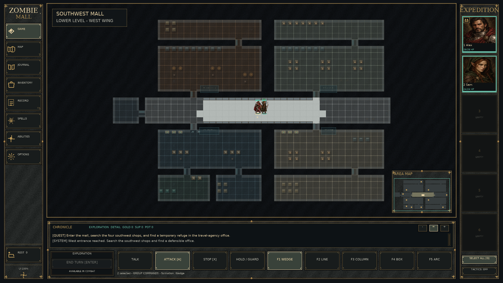
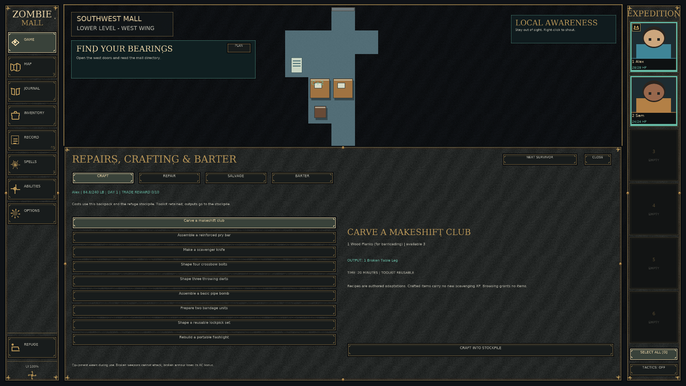
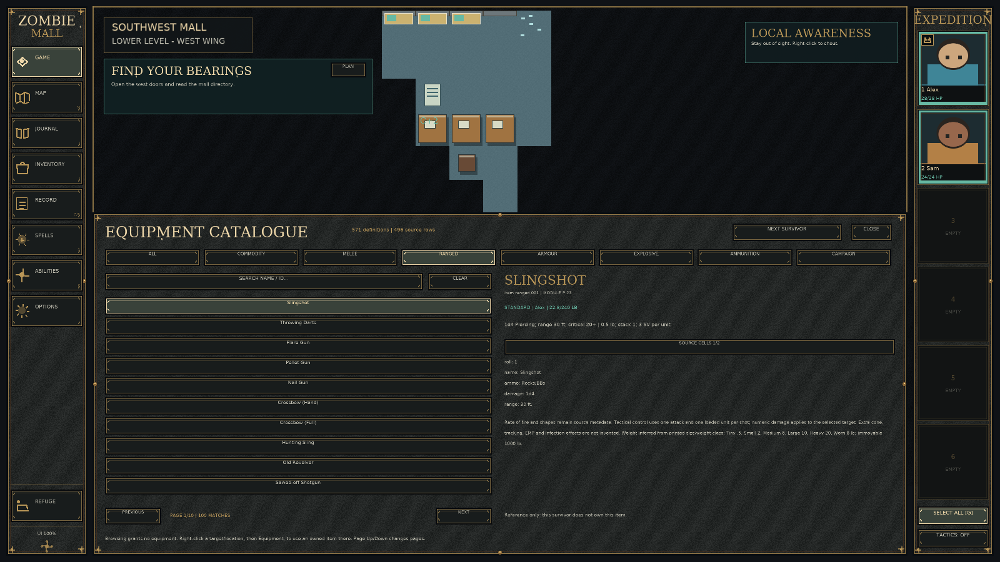
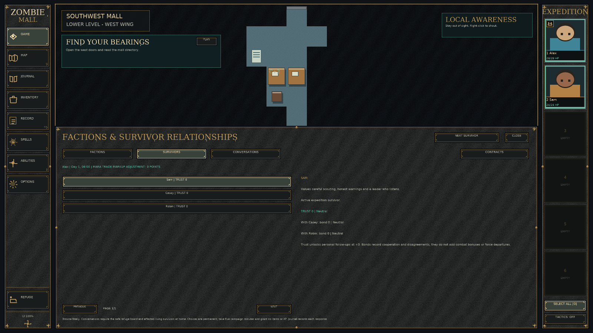

# Zombie Mall

**Survive the outbreak. Explore an enormous abandoned shopping mall. Bring everyone home—or find a way out.**

Zombie Mall is a single-player, party-based zombie-survival RPG by **Michael Robinson**. Explore connected shops, service corridors, rooftops and the surrounding town; manage a refuge and your survivors; scavenge and craft; investigate what happened; and work towards several difficult endings.

This repository contains the complete C# / MonoGame game source, authored campaign data, required artwork and music, automated regression checks, and scripts for producing a portable Windows build.

**Current build:** `0.33.2` · **Primary release:** Windows x64 · **Status:** playable, actively developed · **Licence:** CC BY-SA 4.0 for original work, with separately licensed components (see [Licensing](#licensing)).

## Download and play

1. Open the repository's **Releases** page and download the `ZombieMall-win-x64-...zip` asset (not GitHub's automatic *Source code* ZIP).
2. Extract **the whole archive** into a new folder.
3. Double-click `ZombieMall.exe` and select **START ZOMBIE MALL**.

The Windows package is a **self-contained portable build**: no .NET SDK is needed. Keep `Assets/`, `Campaigns/` and `StylePacks/` alongside the executable. A working OpenGL graphics driver is required. This package is not an installer. See [Playing](docs/PLAYING.md) and [Troubleshooting](docs/TROUBLESHOOTING.md).

## What is in the game?

- **170 connected campaign areas:** 108 mall shops, 25 roof locations, 26 exterior locations, connecting routes and the original refuge.
- **Six survivor classes:** Agile, Charismatic, Smart, Strong, Tough and Wise, with development and class abilities.
- **Exploration and tactical encounters:** real-time party movement, contextual interactions, firearms, awareness, noise, horde pressure, and turn-based combat.
- **Survival systems:** scavenging, persistent inventories, food and water, shelter residents, barricades, electricity, care, resources and daily incidents.
- **Crafting and social play:** repairs, salvage, recipes, finite-stock trade, contracts, factions, relationships and survivor conversations.
- **Mysteries and endings:** persistent evidence, a prepared helicopter escape, a long-term winter-survival route and emergency decisions.
- **Save and continue:** persistent campaigns and local player profiles; existing saves retain their embedded earlier campaign definitions.

**Visual-art status:** build 0.33.2 improves the opening environments and customizes **lower-mall shops 1–18**. Some later areas use shared or earlier-generation art, so art coverage is not yet uniform across the full campaign.

## Screenshots

These are genuine in-game captures from earlier playable builds. Some visuals have been improved since they were taken.

| Mall exploration | Crafting and repairs |
| --- | --- |
|  |  |
| **Equipment catalogue** | **Survivors and faction relationships** |
|  |  |

## Controls at a glance

Click the world to move, attack, or interact. **G** selects the group; **1–6** select individual characters; **Space** pauses exploration; **Enter** ends a combat turn. **M / J / I** open the map, journal and inventory; **F5 / F9** quick-save/load; **F1** opens help. Additional campaign actions are on the in-game sidebars and contextual menus. The [player guide](docs/PLAYING.md) has more detail.

## Build from source

Install the **.NET 10 SDK**. From the repository root:

```sh
dotnet restore ZombieMall.sln
dotnet build ZombieMall.sln -c Release
dotnet run --project tests/Ashen.Tests/Ashen.Tests.csproj -c Release
```

On Windows, run `Build-Windows.bat` to create a portable build in `Windows/`; or use `Play.bat` to build and launch. Non-Windows source builds need appropriate DesktopGL native libraries. The `tests/Ashen.Tests` project is a **headless regression executable**, not an xUnit test project.

See [Building](docs/BUILDING.md), [Architecture](docs/ARCHITECTURE.md), [Campaign format](docs/CONTENT-FORMAT.md) and [Audio](docs/AUDIO.md).

## Repository layout

```text
src/             C# gameplay engine, desktop client and audio components
content/         Authored campaigns and music style definitions
tests/           Headless game-rule and save regression checks
tools/           Optional audio, font and environment-asset generators
packaging/       Windows publishing and distribution instructions
docs/            Player, developer and release guides; selected screenshots
licenses/        Third-party licences and attributions
.github/         CI, tagged-release automation and contribution templates
```

## Contributing and reporting bugs

Contributions and bug reports are welcome. Please read [CONTRIBUTING.md](CONTRIBUTING.md), use the bug/feature issue templates, and include a build version and reproducible steps. Do not upload private saved games or uncensored crash logs. See [SECURITY.md](SECURITY.md) for private vulnerability reporting.

## Licensing

Copyright © 2026 Michael Robinson. Original Zombie Mall/Ashen Covenant work is offered under **Creative Commons Attribution–ShareAlike 4.0 International** ([full licence](LICENSE)). Libraries, font derivations and other components have their **own** licences: see [credits](CREDITS.md), [copyright notice](NOTICE.md) and [component attribution](licenses/ATTRIBUTION.md). Redistribution must preserve applicable notices.

The project is independent of the owners of any games or other works it may evoke.
